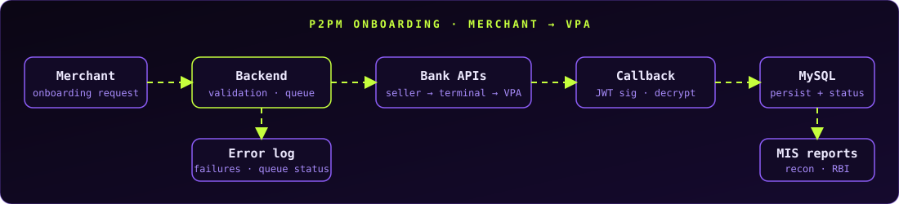
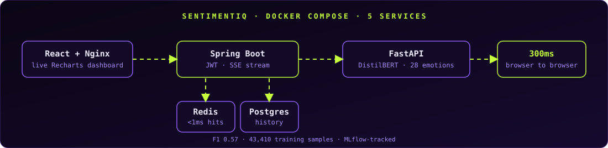

<div align="center">




<a href="https://priyanshch.github.io/portfolio/"></a>
<a href="https://www.linkedin.com/in/priyansh1204"></a>
<a href="https://leetcode.com/u/PriyanshChauhan/"></a>
<a href="mailto:official.priyanshchauhan@gmail.com"></a>
<a href="https://github.com/PriyanshCh?tab=repositories"></a>

</div>

---

## `01 / WHOAMI`

<table>
<tr>
<td width="55%" valign="top">

```yaml
name:      Priyansh Chauhan
role:      Software Developer
domain:    FinTech · UPI · Banking
base:      India 🇮🇳
education: B.Tech CSE · UPES (CGPA 8.04)
focus:     [backend, payments, reporting, applied-ml]
mode:      build deliberately · debug relentlessly
```

I build the parts of fintech that **must not break**: UPI and BBPS payments, bank-API integrations, KYC flows, and the MIS, reconciliation and RBI reports banks run on.

Off the clock I ship ML as a real product: **[SentimentIQ](https://github.com/PriyanshCh/sentimentiq)** takes a fine-tuned DistilBERT all the way to a live dashboard in **300ms**.

</td>
<td width="45%" valign="top" align="center">



</td>
</tr>
</table>

## `02 / EXPERIENCE`

<details open>
<summary><b>⚡ OneStack — Software Development Engineer I</b> &nbsp;<sub>Jun 2025 – Present · Gurugram</sub></summary>
<br/>

- Shipped **22 features** across core banking, UPI payments, KYC and regulatory reporting in PHP (CodeIgniter) and MySQL.
- **Payments:** integrated **Yes Bank** seller and terminal APIs for P2PM merchant onboarding and VPA generation, with callback processing, **JWT signature validation**, encryption and queue-based error tracking.
- **UPI & BBPS:** NPCI-compliant XML integrations serving thousands of daily active users.
- **Performance:** cut MIS report query time by **40%** (6 joins redesigned with covering indexes and query-plan analysis); reports that timed out now load in under 3s.
- **Reporting:** **15+ bank MIS reports**, RBI regulatory reports, and a reconciliation pipeline that saves the ops team about 2 hours a day.
- **Quality:** **150+ automated backend tests** for the CBS Debugger and **12+ production P1/P2 incidents** resolved with zero repeats.

<div align="center">

</div>

</details>

<details>
<summary><b>IBM — Project Intern</b> &nbsp;<sub>Jun 2024 – Aug 2024 · Hybrid</sub></summary>
<br/>

- Built a **Neural Style Transfer** model (Python, OpenCV, deep learning) that turns photos into artistic images.
- Optimised the inference pipeline to reduce processing latency and presented results to mentors and tech leads.

</details>

## `03 / SELECTED BUILDS`

<table>
<tr>
<td width="50%" valign="top">

### 🧠 [SentimentIQ](https://github.com/PriyanshCh/sentimentiq)

**Real-time emotion analysis, 300ms end to end**

Fine-tuned DistilBERT (F1 0.57 across 28 emotions) behind Spring Boot, FastAPI and React, with JWT auth, Redis caching and SSE streaming, in 5 Docker services.

`Java` `Spring Boot` `FastAPI` `DistilBERT` `React` `Docker`

[Source code](https://github.com/PriyanshCh/sentimentiq)

</td>
<td width="50%" valign="top">

### 🔍 [SemantiQ](https://github.com/PriyanshCh/Duplicate-Question-Detection-DQD-)

**Duplicate question detection**

Flags duplicate questions by meaning rather than exact wording, for forums and support desks.

`Python` `Deep Learning` `NLP`

[View repository](https://github.com/PriyanshCh/Duplicate-Question-Detection-DQD-)

</td>
</tr>
<tr>
<td width="50%" valign="top">

### ✋ [Finger Canvas](https://github.com/PriyanshCh/Finger-Canvas-Digital-Sketchpad)

**Gesture-controlled sketchpad**

Draw with finger gestures: MediaPipe hand landmarks tracked at 30 fps on a standard webcam.

`Python` `OpenCV` `MediaPipe`

[View repository](https://github.com/PriyanshCh/Finger-Canvas-Digital-Sketchpad)

</td>
<td width="50%" valign="top">

### 📊 [Sorting Visualizer](https://github.com/PriyanshCh/Sorting-Visualizer)

**Algorithms you can watch**

Animated Bubble, Selection, Insertion, Merge and Quick sort with adjustable size and speed.

`HTML` `CSS` `JavaScript`

[Live demo](https://sorting-algo-4a223a.netlify.app/) · [Source](https://github.com/PriyanshCh/Sorting-Visualizer)

</td>
</tr>
</table>

<div align="center">



</div>

## `04 / ACHIEVEMENTS`

```text
[🏦] PRODUCTION    22 features · 15+ bank MIS reports · 150+ automated backend tests
[⚡] PERFORMANCE   MIS queries cut by 40% · slow reports now load in under 3s
[🧠] ML IN PROD    DistilBERT fine-tuned on 43,410 samples, served at 300ms end to end
[⚔️] DSA           300+ problems solved in Java (LeetCode)
[🎓] EDUCATION     B.Tech CSE, UPES · CGPA 8.04 · IBM project intern
```

## `05 / TECH ARSENAL`

<div align="center">


</div>

| Domain | Technologies |
| --- | --- |
| **Languages** | Java, PHP, Python, SQL, JavaScript |
| **Backend** | Spring Boot, CodeIgniter, Symfony, FastAPI, REST APIs, JWT, SSE |
| **Payments / FinTech** | UPI & BBPS (NPCI), Yes Bank P2PM APIs, KYC (Face Liveness, eKYC), MIS & RBI reporting |
| **Frontend** | React, Recharts, JavaScript, Bootstrap, jQuery |
| **Data** | MySQL (query tuning, indexing), PostgreSQL, Redis |
| **Infrastructure** | Docker, Docker Compose, Nginx, AWS, Git |
| **AI / ML** | PyTorch, Hugging Face Transformers, DistilBERT, MLflow, OpenCV, NLP |

## `06 / GITHUB TELEMETRY`

<div align="center">


<br/>


</div>

## `07 / CURRENT FOCUS`

```bash
$ focus --now
> System design & backend architecture
> Docker Compose: scaling, load balancing, health checks
> Database performance: indexing, query plans, reconciliation at scale
> Applied ML: shipping models behind real APIs
> DSA: steady reps in Java
```

## `08 / LATEST WRITING`

```text
// 30 days of learning Docker, written down in public on LinkedIn
```

[Follow along on LinkedIn →](https://www.linkedin.com/in/priyansh1204)

---

<div align="center">


<sub>LESS NOISE. BETTER SYSTEMS. CONSISTENT EXECUTION.</sub>

</div>
