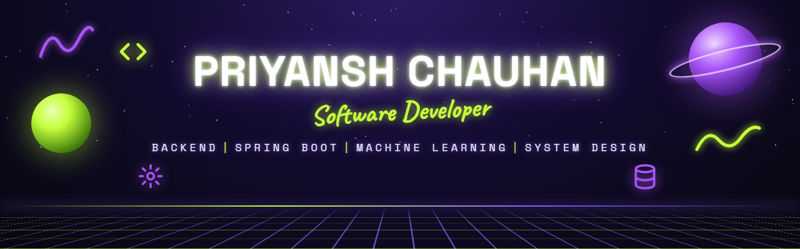

  

## Connect with me 🤝

  
  
  
  

## About Me 😊

- 🏦 Software Engineer @ **OneStack**: core banking, UPI and KYC systems in PHP (CodeIgniter) and MySQL
- 💳 Built the **Yes Bank P2PM** integration, 15+ bank MIS reports and 150+ automated backend tests
- 🧠 Built **[SentimentIQ](https://github.com/PriyanshCh/sentimentiq)**: fine-tuned DistilBERT behind Spring Boot + FastAPI + React, **300ms end to end**
- 🎓 B.Tech CSE, UPES (2021–25) · ex-Project Intern @ IBM
- ⚔️ 300+ DSA problems solved in Java
- 🐳 Currently learning: Docker, system design and scaling
- 📫 Reach me: **official.priyanshchauhan@gmail.com**

## Tech Stack 🛠️

  

## Stats 📊

  
  

  
  

